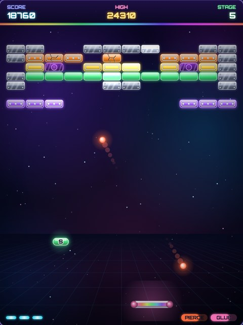
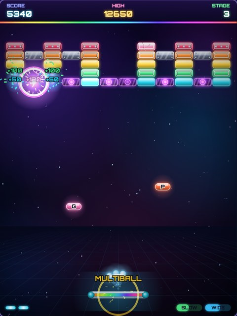
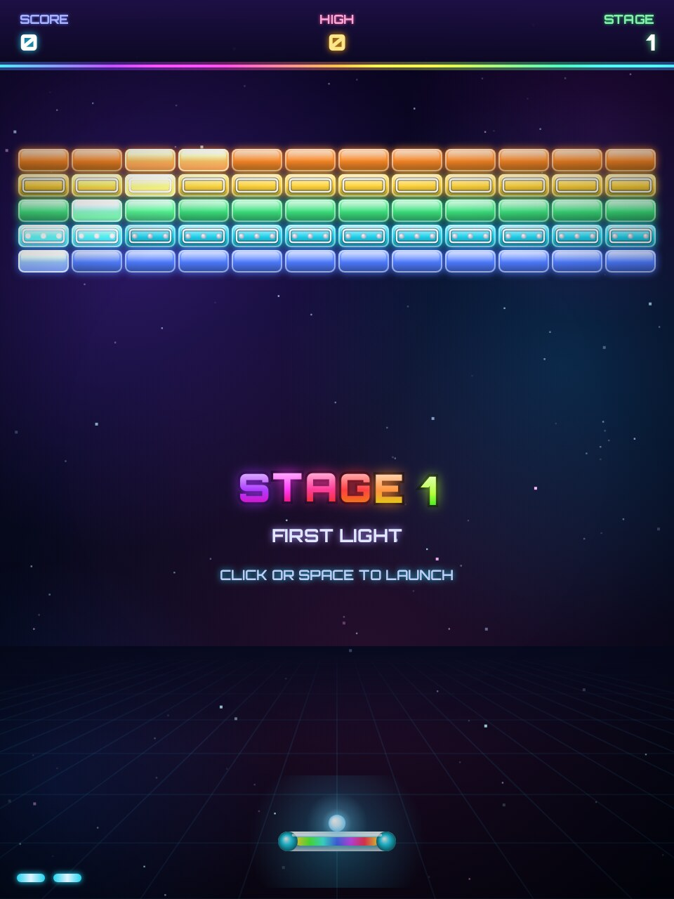
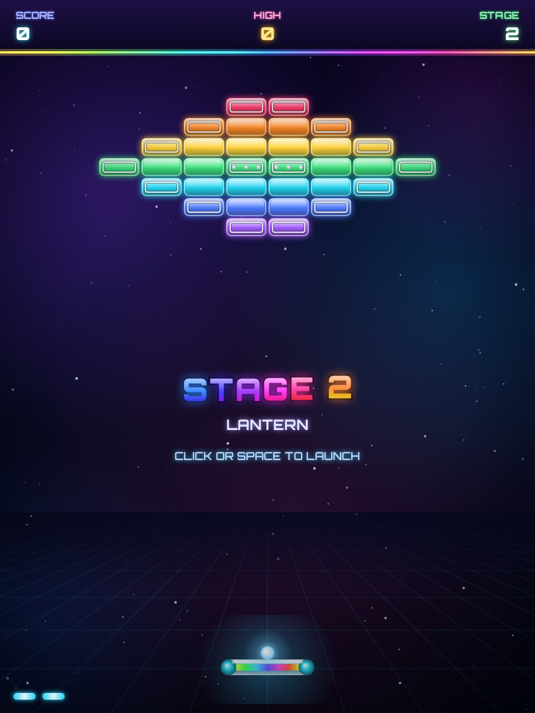
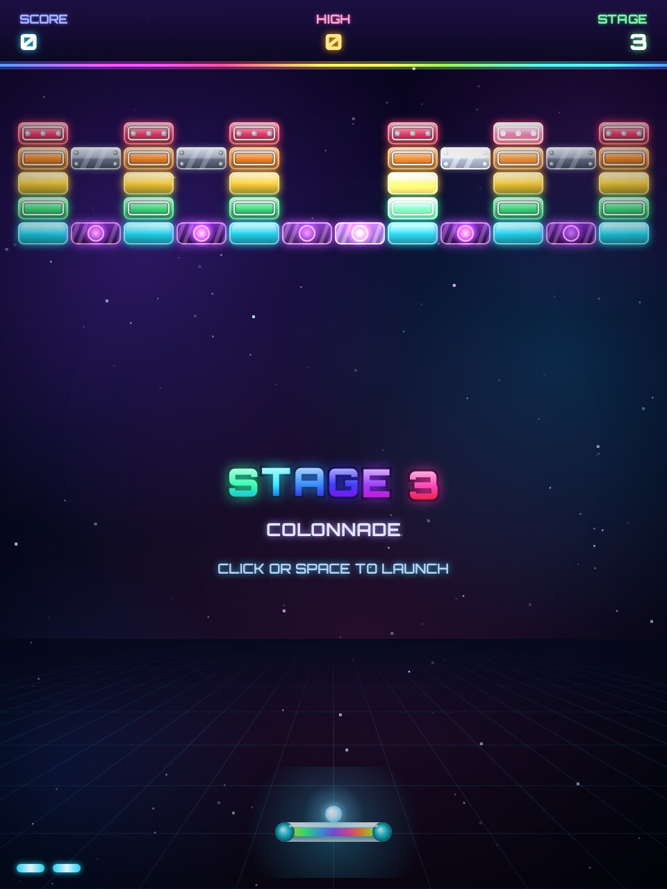
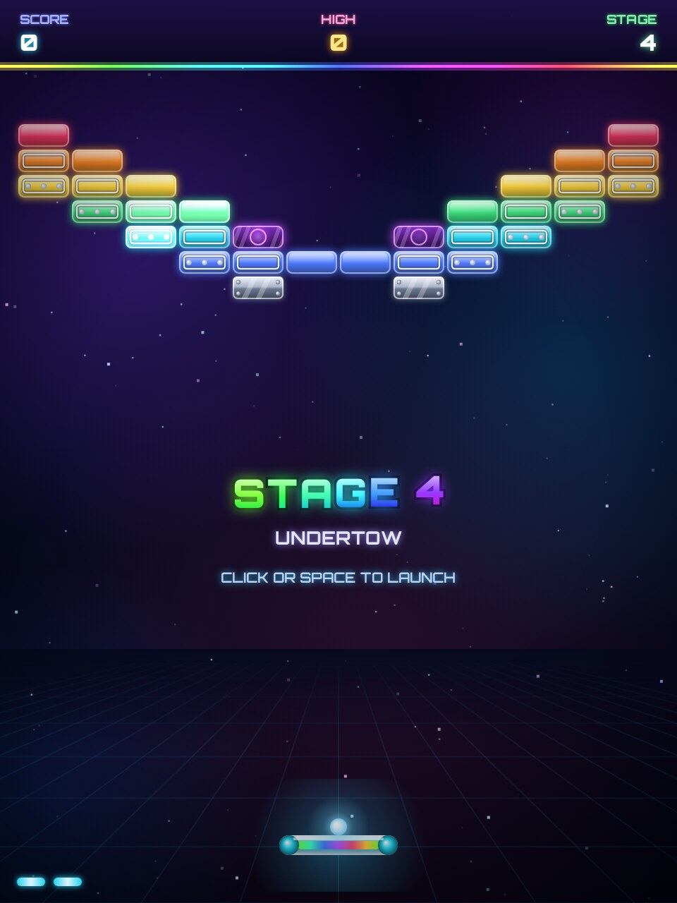
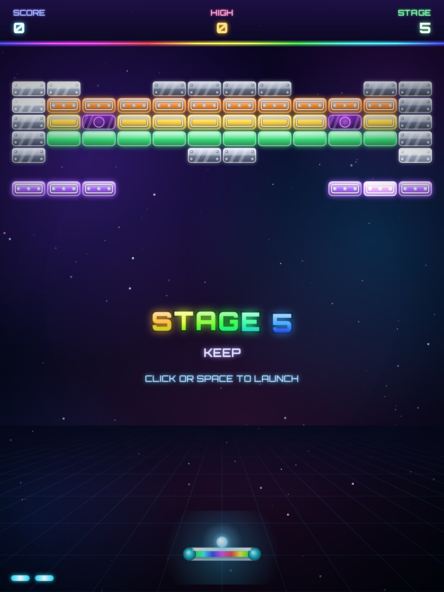
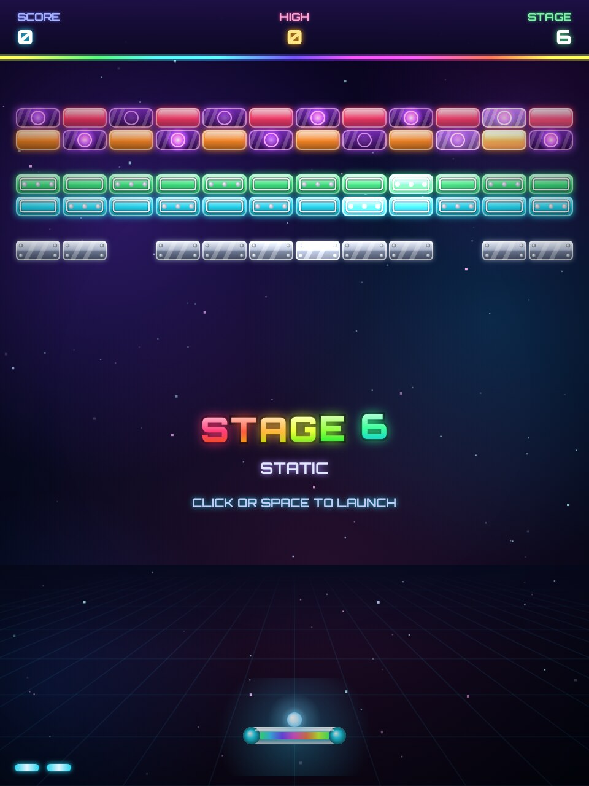

# Shardline

A neon brick-breaker for the browser in the style of classic paddle-and-ball games like Arkanoid and Breakout, with its own original levels, power-ups and look. Built with plain HTML5 Canvas and JavaScript: no build step, no dependencies, and no image assets, everything is drawn in code.

<sub>Shardline is an independent project and is not affiliated with or endorsed by the owners of Arkanoid or Breakout.</sub>

**Play it here:** https://wigy.github.io/shardline/

<p align="center">
  
  
</p>

## Controls

| Action | Keys |
| --- | --- |
| Move paddle | Mouse, touch, ← → or A / D |
| Launch ball / start | Click, tap, Space or Enter |
| Pause | P or Esc |
| Mute | M |

## Features

- Six handcrafted stages. After the last one the game loops faster, with a higher score multiplier.
- Bricks that take 1–3 hits, unbreakable steel, and purple charge bricks that blow up their neighbours (chain reactions included).
- Power-ups: **W**ide paddle, **M**ultiball, **S**low ball, **G**lue paddle, **P**ierce, and **+** extra life.
- Particle effects, screen shake, synthesized sound effects, and a high score saved in the browser.

## Stages

Click a picture to see it at full size.

<table>
  <tr>
    <td align="center"><a href="docs/levels/level-1.jpg"></a><br><b>1.</b> First Light</td>
    <td align="center"><a href="docs/levels/level-2.jpg"></a><br><b>2.</b> Lantern</td>
    <td align="center"><a href="docs/levels/level-3.jpg"></a><br><b>3.</b> Colonnade</td>
  </tr>
  <tr>
    <td align="center"><a href="docs/levels/level-4.jpg"></a><br><b>4.</b> Undertow</td>
    <td align="center"><a href="docs/levels/level-5.jpg"></a><br><b>5.</b> Keep</td>
    <td align="center"><a href="docs/levels/level-6.jpg"></a><br><b>6.</b> Static</td>
  </tr>
</table>

## Running locally

Open `index.html` in a browser, or serve the folder:

```sh
python3 -m http.server
```
